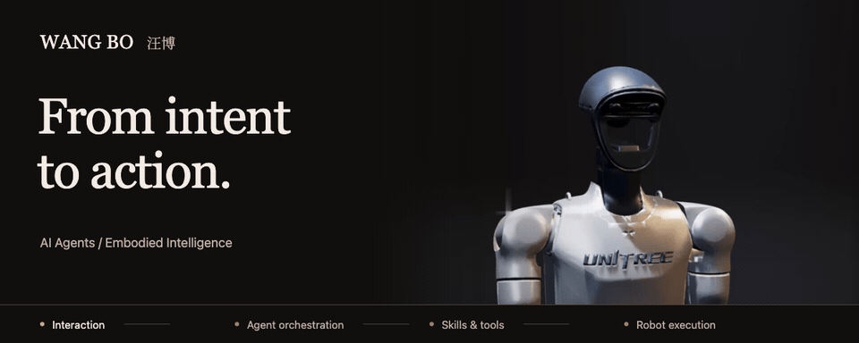
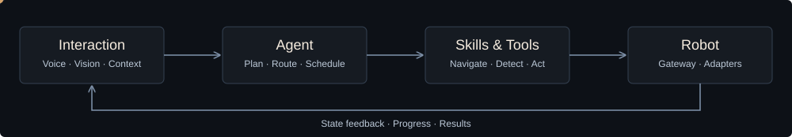

[English](README.md) · **中文**

<picture>
  <source media="(prefers-reduced-motion: reduce)" srcset="assets/hero-closeup.png">
  
</picture>

# 汪博 · Wang Bo

**AI Agent / Embodied Intelligence Developer**

目前在 **武汉人工智能研究院** 从事 **AI Agent 与具身智能 Agent 开发**（2024 年 10 月—至今）。我关注如何把自然语言、感知、任务编排与机器人执行连接起来，让 Agent 的能力进入真实场景。

我主导完成 **RoboClaw、具身智能数据采集系统和具身智能实训平台** 的设计与开发，工作覆盖机器人交互与控制、导航讲解巡检、数据采集管理，以及面向真实机器人的教学实践。

[个人作品集](https://wander521.github.io/robot-portfolio/) · [联系我](https://wander521.github.io/robot-portfolio/#contact)

## 从交互，到执行

- **Agent 与交互**：Nanobot 任务编排、Skills 与工具调用、实时语音和打断处理、会话状态、定时任务与提醒。
- **机器人与执行**：宇树 Unitree G1、乐聚 Kuavo 4PRO MaxA 适配，强脑科技灵巧手控制，SLAM 建图与定位服务接入、点位导航、展厅讲解与路线巡检。
- **感知与操作**：视觉检测、坐标转换、双臂抓取放置流程，以及 VLA 推理服务接入。
- **数据与教学**：Task / Episode / Dataset 管理、LeRobot 转换、标注与多相机回放、课程组织和机器人 Notebook 实践。

## 我主导的项目

### RoboClaw

**具身智能交互与机器人任务执行平台**

基于 Nanobot 扩展 Agent 能力，将语言交互、任务计划、Skills／工具调用、机器人网关与硬件适配连接成执行链路。

- 接入实时语音、视觉检测、遥控接管、机器人动作与灵巧手控制；支持宇树 G1 和乐聚 Kuavo 4PRO MaxA。
- 对接机器人端 SLAM 与定位服务，开发地图、点位、路线管理，将导航、讲解音频和动作组织为展厅导览与巡检任务。
- 开发点云可视化大屏，展示激光雷达点云、机器人位置、朝向与行进路径；配套独立巡检平台和设备端执行服务。
- 开发配套 Android App **HiRobo**，连接设备管理、对话、遥控、技能与任务；集成双臂抓取放置流程和 VLA 服务。

[查看项目与演示 →](https://wander521.github.io/robot-portfolio/projects/roboclaw/)

### 具身智能数据采集系统

**embodied-ai-data-collect · 从机器人操作，到可管理的数据资产**

围绕 Task、Episode 与 Dataset 组织采集业务，连接任务分配、机器人租约、采集控制、上传转换、数据集管理与标注。

- 打通设备运行时、采集状态与事件回传，使任务和采集过程可追踪。
- 组织 Episode 上传、LeRobot 格式转换、数据集管理与标注流程。
- 接入多相机、动作和状态的同步回放，支持采集数据检查与问题定位。

[查看项目与演示 →](https://wander521.github.io/robot-portfolio/projects/embodied-ai-data-collect/)

### 具身智能实训平台

**从课程组织，到真实机器人上的代码实验**

连接课程内容、班级教学、学习进度和机器人实验入口，让教师组织教学，让学生在授权环境中开展实践。

- 开发课程包导入与发布、班级和选课管理、章节学习与实验产物提交。
- 接入受保护的 Notebook 环境与机器人绑定，连接代码实验、ROS 2 和机器人动作。
- 组织教师端与学生端的教学流程，将课程学习与设备实践衔接起来。

[查看项目与演示 →](https://wander521.github.io/robot-portfolio/projects/embodied-ai-training/)

## 工程技术栈

      

## 技术与工程基础

| 方向 | 使用的技术与能力 |
| --- | --- |
| Agent / 交互 | Python、Nanobot、Skills、工具调用、实时语音、视觉 / VLA 服务接入 |
| 机器人 | ROS 1 / ROS 2、Bridge、控制网关、硬件适配、导航巡检、灵巧手控制 |
| 数据 / 平台 | FastAPI、Java、MySQL、Redis、LeRobot、Notebook、监控与部署 |
| 设备应用 | Android 应用、Android 操作系统开发与定制化 |

<strong>此前的工程与数据经历</strong>

- **2023.02—2024.09 · K12 教育公司**：题库数据业务与平台建设，围绕采集、清洗、标注、结构化和开放服务，为字节、快手等客户的大模型预训练提供数据业务支撑。
- **2018.10—2022.11 · 某AI四小龙 (Megvii)**：参与 AI 数据采集、清洗处理与项目管理平台研发，建设任务调度、服务监控与稳定性能力。
- **2015.07—2018.10 · 某通信公司(FiberHome)**：Android 操作系统开发与定制化，参与需求适配、系统集成与软件交付。

**武汉大学** · 地理信息系统本科 / 测绘工程（GIS 方向）硕士

## 社区

  

## 内容与平台

       

新渠道筹备中，公开主页地址准备好后再绑定。

## GitHub Activity

<picture>
  <source media="(prefers-reduced-motion: reduce) and (prefers-color-scheme: dark)" srcset="assets/activity-dark-static.svg">
  <source media="(prefers-reduced-motion: reduce)" srcset="assets/activity-light-static.svg">
  <source media="(prefers-color-scheme: dark)" srcset="assets/activity-dark.svg">
  
</picture>

根据我的公开贡献记录生成，每日更新。许多项目工作并不保存在公开 GitHub 仓库中。

## 一起让机器人行动

欢迎交流 **AI Agent、具身智能应用、机器人系统、数据采集与实训平台**，也欢迎研发岗位与项目合作机会。

**武汉** · 联系方式见个人作品集

[联系我](https://wander521.github.io/robot-portfolio/#contact) · [浏览完整作品集](https://wander521.github.io/robot-portfolio/)

视觉素材与模型来源见 [素材说明](assets/CREDITS.md)。
